 <div align="center">


# AEGISX

### GLOBAL CYBER THREAT INTELLIGENCE

**Next-Generation Cyber Threat Intelligence Desktop Platform for Kali Linux**

[](https://github.com/silent-days/AegisX)
[](https://www.python.org/)
[](https://www.kali.org/)
[](LICENSE)

**Collect • Analyze • Correlate • Investigate • Protect**

[Installation](#installation) · [Features](#key-features) · [Screenshots](#screenshots) · [API Setup](#api-configuration) · [Architecture](#project-architecture)

**Developed by Silent Days**

</div>

---

## Overview

**AegisX** is a next-generation Global Cyber Threat Intelligence platform designed as a native desktop application for Kali Linux.

Built with Python and PySide6, AegisX provides a centralized environment for collecting, analyzing, correlating, and visualizing cyber threat intelligence from multiple OSINT sources.

The platform investigates suspicious IP addresses, domains, and network infrastructure through real intelligence providers, evidence-based risk scoring, interactive visualizations, and professional investigation reports.

AegisX combines multiple intelligence capabilities into one modern desktop interface, helping security researchers and cybersecurity professionals understand and investigate potential threats.

### Intelligence Without Fabrication

AegisX follows an evidence-based intelligence approach:

- Keyless community sources provide real intelligence without API keys.
- Optional API integrations expand intelligence coverage.
- Unconfigured providers are clearly identified.
- Demonstration records use reserved documentation IP ranges and example domains.
- Threat attribution is never presented as fact without supporting evidence.

---

## Screenshots

Explore the AegisX desktop interface and its intelligence capabilities.

### Command Center

| Dashboard | Global Threat Map |
|:---:|:---:|
| 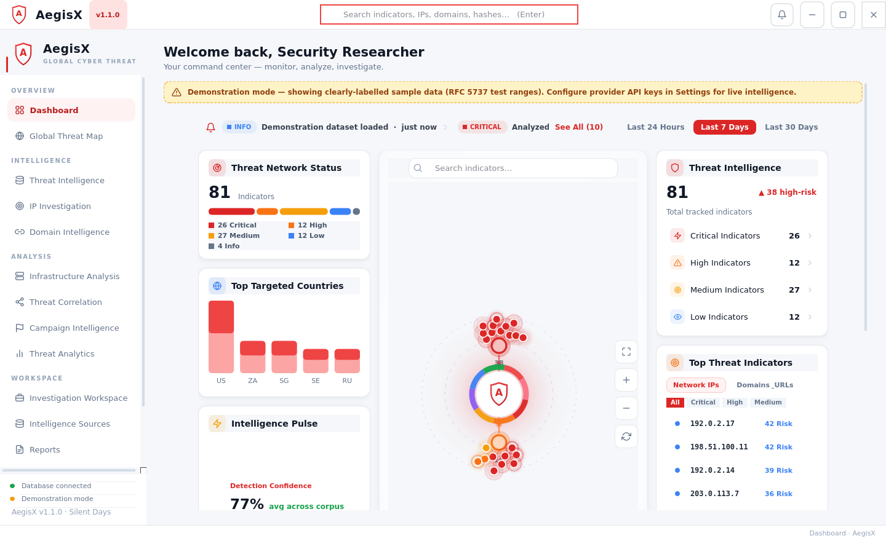 | 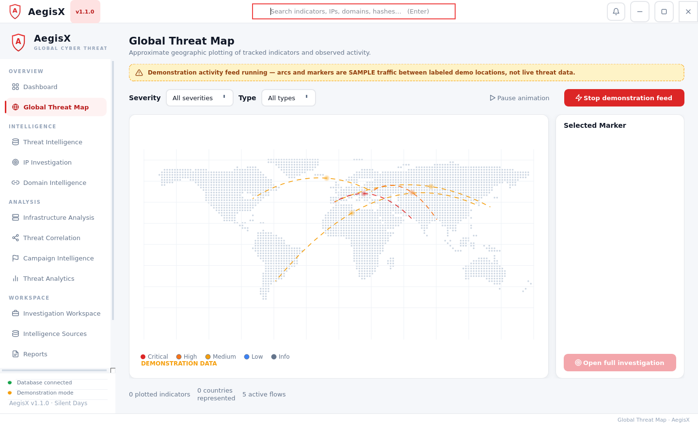 |
| **Main Intelligence Dashboard** | **Global Threat Visualization** |

### Threat Investigation

| IP Investigation | Domain Intelligence |
|:---:|:---:|
| 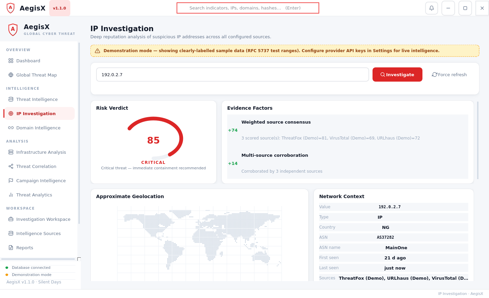 | 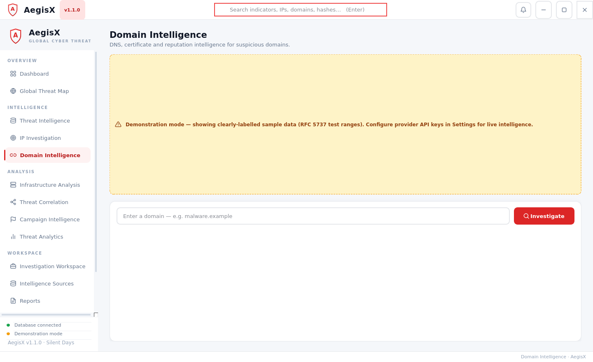 |

### Intelligence & Analytics

| Threat Analytics | Threat Correlation |
|:---:|:---:|
| 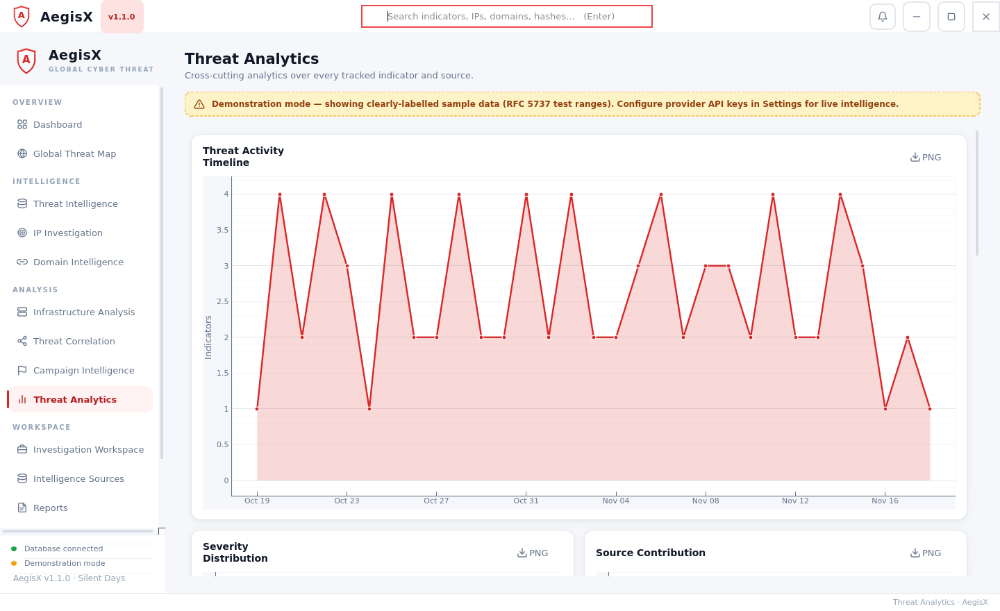 | 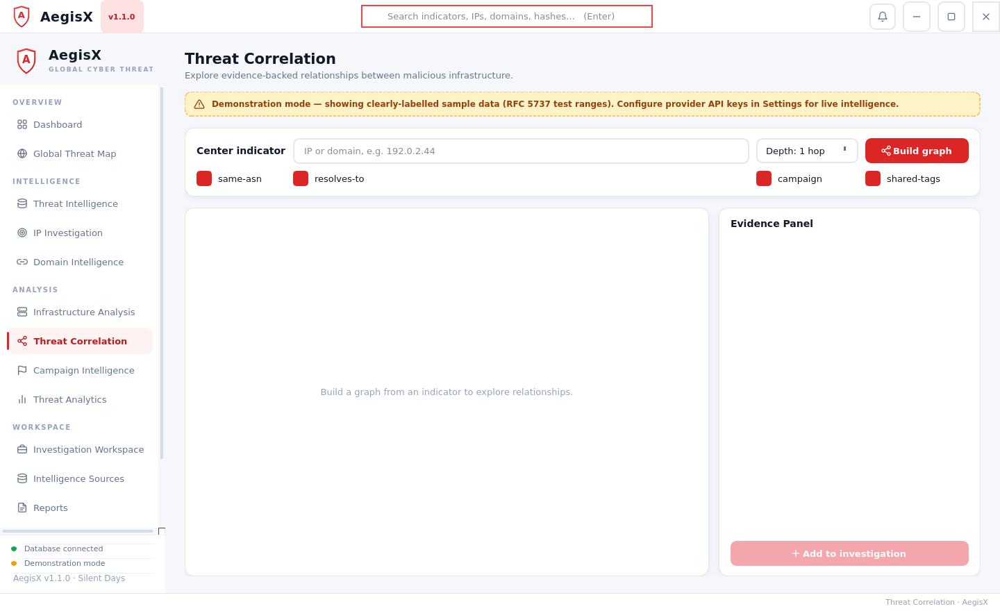 |

| Campaign Intelligence | Infrastructure Analysis |
|:---:|:---:|
| 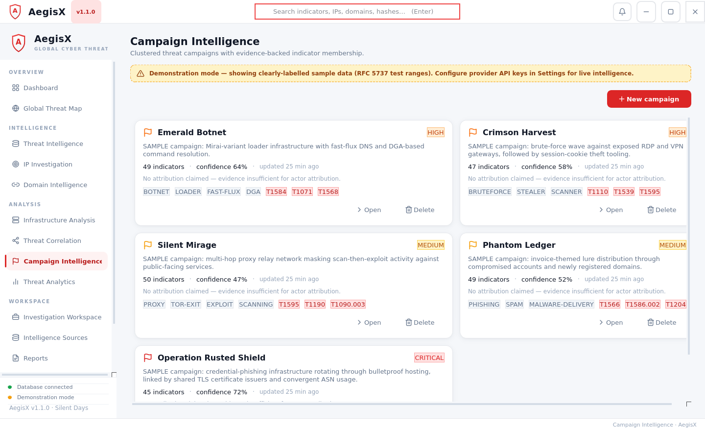 | 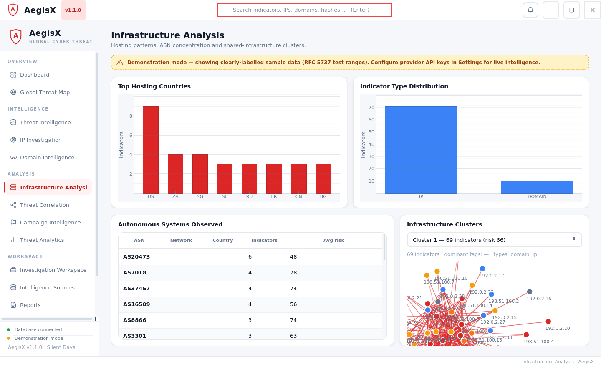 |

### Investigation & Reporting

| Investigation Workspace | Professional Reports |
|:---:|:---:|
| 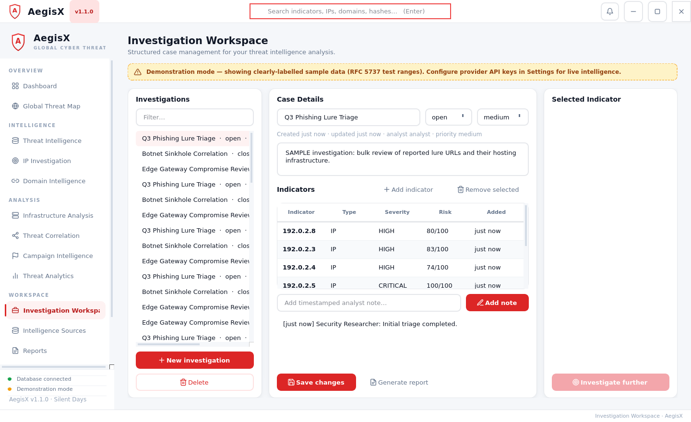 | 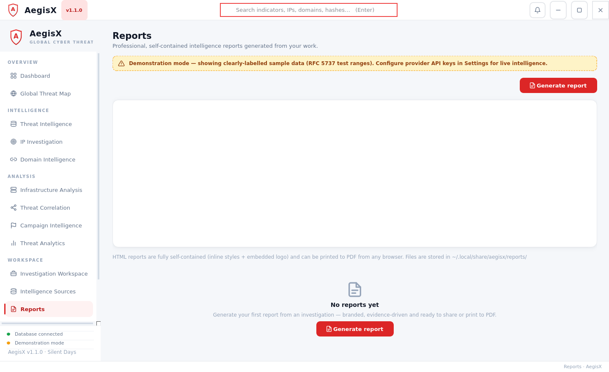 |

### Threat Management

| Threat Intelligence | Intelligence Sources |
|:---:|:---:|
| 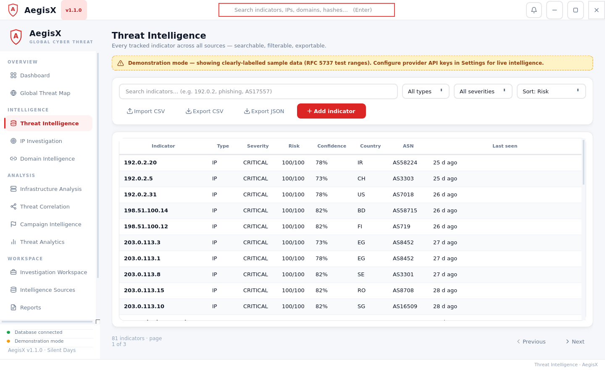 | 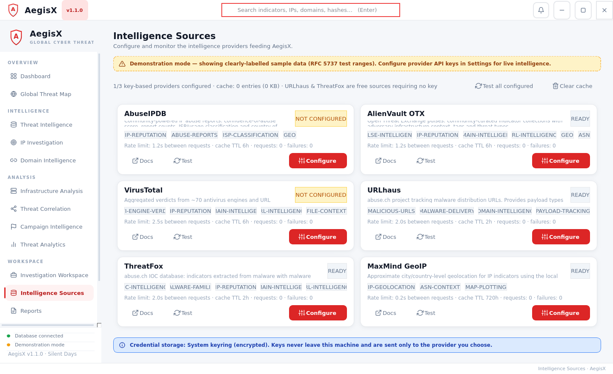 |

### Application

| Settings | About AegisX |
|:---:|:---:|
| 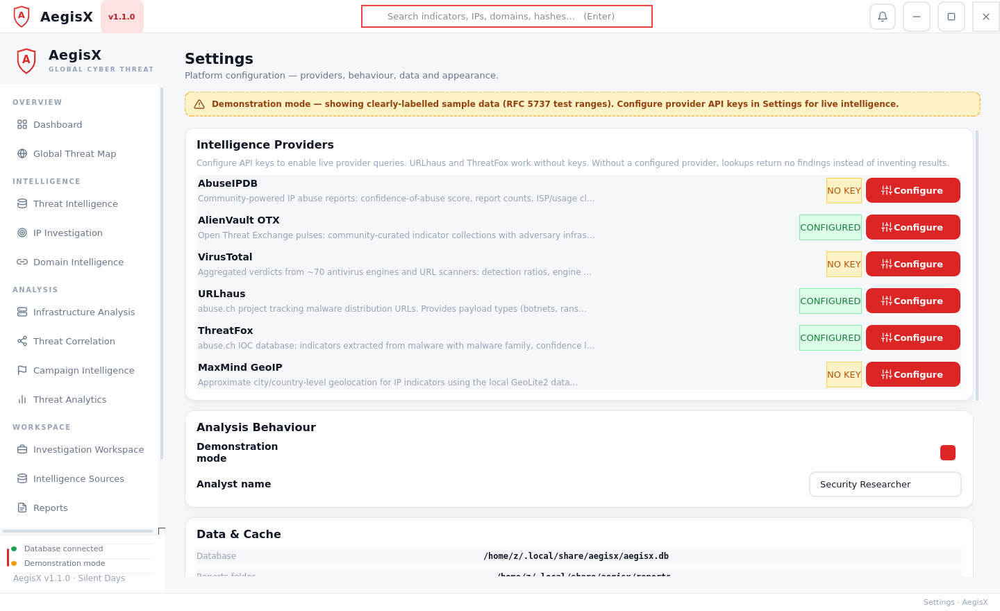 | 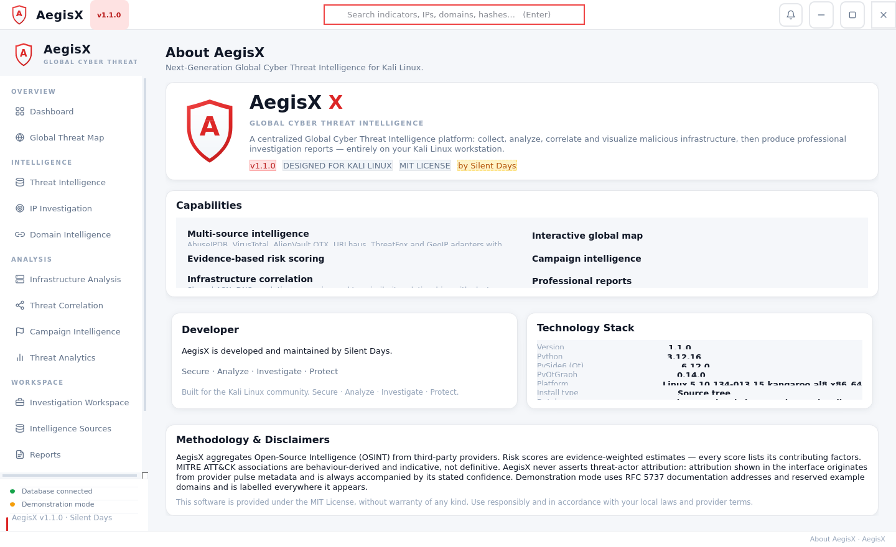 |

---

## Key Features

### 1. Intelligence Command Center

- Modern centralized security dashboard.
- Animated threat monitoring indicators.
- 3D command gauges and threat statistics.
- Live-style global network topology visualization.
- Severity overview and activity timeline.
- Top threat indicators with filtering.
- Intelligence activity monitoring.

### 2. Advanced Threat Intelligence

- Centralized indicator management.
- IP address and domain investigation.
- Risk-based threat classification.
- Advanced filtering by source, tag, risk, and recency.
- Bulk indicator management.
- Re-analysis and export functionality.

### 3. Global Threat Map

- Interactive world threat visualization.
- Severity-based threat markers.
- Animated attack-flow visualization.
- Global threat activity feed.
- Offline-capable map visualization.

### 4. IP Investigation

- Multi-provider IP reputation analysis.
- IP geolocation and ASN information.
- Abuse confidence and reputation evidence.
- Animated risk gauge.
- MITRE ATT&CK technique associations.
- Provider-based intelligence results.

### 5. Domain Intelligence

- DNS record investigation.
- Domain resolution.
- TLS certificate inspection.
- Certificate transparency subdomain discovery.
- Domain reputation analysis.

### 6. Infrastructure Analysis

- ASN concentration analysis.
- Hosting country statistics.
- Indicator distribution.
- Infrastructure cluster visualization.
- Interactive relationship graphs.

### 7. Threat Correlation

- Evidence-based relationship discovery.
- Shared ASN correlation.
- DNS relationship analysis.
- Campaign and tag similarity.
- Interactive graph visualization.
- Supporting evidence inspection.

### 8. Campaign Intelligence

- Threat campaign clustering.
- Campaign timelines.
- Confidence-based intelligence.
- Related indicator analysis.
- Evidence-based attribution handling.

### 9. Threat Analytics

- Threat activity statistics.
- Severity distribution.
- Confidence analysis.
- Intelligence source contribution.
- MITRE ATT&CK technique frequency.
- PNG chart export.

### 10. Investigation Workspace

- Centralized investigation management.
- Investigation items and evidence.
- Timestamped investigation notes.
- Multi-panel workspace.
- One-click report generation.

### 11. Intelligence Source Management

- Centralized provider configuration.
- Real provider connectivity tests.
- Capability and status indicators.
- Rate-limit management.
- Cache statistics.
- Optional API integrations.

### 12. Professional Reporting

- Branded HTML investigation reports.
- JSON report exports.
- Evidence and source attribution.
- Risk and confidence information.
- Investigation methodology and disclaimers.

---

## Technology Stack

| Component | Technology |
|---|---|
| Programming Language | Python 3.9+ |
| Desktop GUI | PySide6 / Qt 6 |
| Data Visualization | PyQtGraph |
| Custom Graphics | QPainter |
| Database | SQLite |
| HTTP Requests | Requests |
| Intelligence Engine | Pure Python |
| Security | System Keyring / Encrypted Key Storage |
| Background Tasks | QThreadPool |
| Operating System | Kali Linux / Debian |

---

## Installation

### Requirements

- Kali Linux or compatible Debian-based distribution.
- Python 3.9 or newer.
- Internet connection for initial installation.
- Root privileges for system-wide installation.

### 1. Clone the Repository

```bash
git clone https://github.com/silent-days/AegisX.git
cd AegisX/AegisX/assets
```

### 2. Install AegisX

```bash
sudo bash install.sh
```

The installer automatically:

1. Detects the operating system.
2. Checks Python compatibility.
3. Installs required system dependencies.
4. Creates the `/opt/AegisX/` directory.
5. Copies application files.
6. Creates an isolated Python virtual environment.
7. Installs required Python packages.
8. Configures the system-wide launcher.
9. Creates a Kali Applications Menu entry.
10. Installs the application icon.
11. Applies safe file permissions.
12. Validates the installation.

**Note:** The installer is designed to be re-run safely for upgrades while preserving existing user data.

### 3. Launch AegisX

```bash
aegisx
```

Alternatively, open **Kali Applications → Security → AegisX**.

---

## API Configuration

AegisX integrates multiple intelligence providers to expand investigation capabilities.

### Built-in Keyless Intelligence

These community sources work without API keys:

| Provider | Capabilities |
|---|---|
| Community DNS Intel | Spamhaus reputation, Tor exit-node detection, reverse DNS |
| DNS over HTTPS | A, NS, MX, TXT records and DNS intelligence |
| OpenGeo Web | IP geolocation, country, city, ASN, organization |

### Optional Intelligence Providers

| Provider | API Key | Purpose |
|---|:---:|---|
| AbuseIPDB | Required | IP abuse reputation |
| AlienVault OTX | Required | Threat intelligence pulses |
| VirusTotal | Required | Multi-engine threat analysis |
| URLhaus | Free Auth-Key | Malicious URL intelligence |
| ThreatFox | Free Auth-Key | Malware-related IOC intelligence |
| MaxMind GeoIP | Local Database | IP geolocation |

### Configure API Keys

1. Open AegisX.
2. Navigate to **Settings → Intelligence Sources**.
3. Select the provider.
4. Open its configuration dialog.
5. Enter the API key.
6. Test the connection.
7. Save the configuration.

API credentials are stored using the system keyring when available, with an encrypted local-file fallback.

**Important:** URLhaus and ThreatFox require a free abuse.ch Auth-Key for their data queries.

### API Resources

- [AbuseIPDB](https://www.abuseipdb.com/account/api)
- [AlienVault OTX](https://otx.alienvault.com/settings/api)
- [VirusTotal](https://docs.virustotal.com/reference/overview)
- [abuse.ch Authentication](https://auth.abuse.ch/)
- [MaxMind GeoLite2](https://dev.maxmind.com/geoip/docs/databases/city-and-country)

Detailed instructions: [API Setup Guide](AegisX/assets/docs/API_SETUP.md).

---

## Project Architecture

```text
AegisX/
├── README.md
├── LICENSE
└── AegisX/
    └── assets/
        ├── install.sh
        ├── uninstall.sh
        ├── upgrade.sh
        ├── run.sh
        ├── entrypoint.py
        ├── requirements.txt
        ├── config.example.env
        ├── src/
        │   └── aegisx/
        ├── icons/
        │   ├── aegisx.png
        │   ├── aegisx-64.png
        │   └── aegisx-128.png
        ├── logos/
        │   └── aegisx-logo.png
        ├── screenshots/
        │   ├── dashboard.png
        │   ├── global_map.png
        │   ├── ip_investigation.png
        │   ├── domain_intelligence.png
        │   ├── analytics.png
        │   ├── correlation.png
        │   ├── campaigns.png
        │   ├── infrastructure.png
        │   ├── investigations.png
        │   ├── threat_intelligence.png
        │   ├── sources.png
        │   ├── reports.png
        │   ├── settings.png
        │   └── about.png
        ├── docs/
        │   ├── API_SETUP.md
        │   ├── ARCHITECTURE.md
        │   ├── DEVELOPMENT.md
        │   ├── FEATURES.md
        │   └── INSTALLATION.md
        ├── scripts/
        └── tests/
```

---

## Security & Privacy

AegisX is designed with security-conscious development practices.

- **Secure Credentials:** API keys are stored through the system keyring when available, with an encrypted local fallback.
- **HTTPS Communication:** Intelligence providers are accessed through their official endpoints.
- **Request Protection:** Provider requests use timeouts, retry/backoff, rate limiting, and caching.
- **Local Storage:** Investigation data and reports are stored locally.
- **No Telemetry:** No third-party analytics or application telemetry.
- **Honest Intelligence:** Demonstration data is clearly separated from live intelligence.
- **Evidence-Based Analysis:** Findings include source attribution and confidence information.

---

## Development

### Run from Source

```bash
cd AegisX/AegisX/assets
bash run.sh
```

### Run Tests

```bash
cd AegisX/AegisX/assets
python -m pytest tests/
```

### Useful Commands

```bash
aegisx --version
aegisx --info
```

### Upgrade

```bash
cd AegisX/AegisX/assets
sudo bash upgrade.sh --backup
```

### Uninstall

Remove the application while preserving user data:

```bash
cd AegisX/AegisX/assets
sudo bash uninstall.sh
```

Remove application and user data:

```bash
cd AegisX/AegisX/assets
sudo bash uninstall.sh --purge-data
```

**Warning:** The purge option removes stored configuration, investigations, reports, and logs after confirmation.

---

## Documentation

- [Installation Guide](AegisX/assets/docs/INSTALLATION.md)
- [API Setup Guide](AegisX/assets/docs/API_SETUP.md)
- [Architecture Documentation](AegisX/assets/docs/ARCHITECTURE.md)
- [Development Guide](AegisX/assets/docs/DEVELOPMENT.md)
- [Features Documentation](AegisX/assets/docs/FEATURES.md)

---

## Project Information

| Information | Details |
|---|---|
| Project | AegisX |
| Version | 1.0 |
| Category | Cyber Threat Intelligence |
| Platform | Kali Linux |
| Language | Python |
| GUI Framework | PySide6 |
| Developer | Silent Days |
| License | MIT |

---

## Disclaimer

AegisX is developed for cybersecurity research, defensive security analysis, threat intelligence, and educational purposes.

Users are responsible for ensuring that their investigations and activities comply with applicable laws, regulations, and third-party service terms.

AegisX is an independent project and is not affiliated with or endorsed by Kali Linux, Offensive Security, or any integrated intelligence provider.

---

## License

This project is released under the **MIT License**.

See the [LICENSE](LICENSE) file for details.

---

<div align="center">


### AEGISX

**Global Cyber Threat Intelligence**

Built with precision. Powered by intelligence.

**Developed by Silent Days**

[GitHub Repository](https://github.com/silent-days/AegisX)

*Secure • Analyze • Investigate • Protect*

</div>
